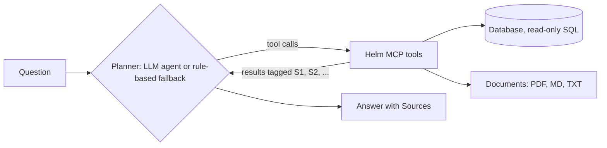

<p></p>

# PeakWhale™ Helm
### Ask your own data. Get answers with sources.


[](https://github.com/PeakWhale/helm/actions/workflows/ci.yml)

**PeakWhale™ Helm** is a local-first research assistant. It answers questions from your database and your documents, and shows where each fact came from: the SQL query and row count, or the file and chunk.

* **MCP server** (`helm-mcp`): plug it into Claude Desktop, Cursor or any MCP client for safe, read-only access to your data.
* **Chat app** (Chainlit): a planner picks the tools for each question. It uses a local model in Ollama, any OpenAI-compatible API, or no model at all (a simple rule-based fallback).

**Who it is for:** analysts and small teams who want answers from their own data without sending it to a cloud service, and developers who want a safe data tool for their AI assistant.

> [!NOTE]
> The demo data is synthetic. All names, numbers and documents are made up.

## Quick start (demo)

You need Python 3.11+ and [uv](https://docs.astral.sh/uv/).

```bash
uv sync --extra ui            # 1. install
uv run helm-demo              # 2. create the demo data
uv run chainlit run app.py    # 3. open http://localhost:8000
```

Ask: *Find the top high risk customer and check their loan application for income source.*

For full LLM answers, install [Ollama](https://ollama.com) and run `ollama pull llama3.2`. Without a model, Helm still answers simple questions. No UI? Try `uv run helm-ask "How many customers are there?"`.

## How it works



The planner can call several tools and use one result in the next call. Each tool result gets a tag like `[S1]`, the answer cites these tags, and a **Sources** list at the end says which SQL ran (and how many rows came back) or which file and chunk was used.

| Tool | What it does |
| --- | --- |
| `list_tables` / `describe_table` | tables, row counts, columns, sample rows and saved queries |
| `query` | one read-only `SELECT` or `WITH` query, with a row limit |
| `list_documents` / `search_documents` | files, and the best matching chunks with file name and chunk number |
| `get_stock_price` / `analyze_sentiment` | optional, off by default |

## Use it with your own data

Point Helm at your data with two environment variables (or edit `helm.toml`), then check what it sees:

```bash
export HELM_DB=/path/to/data      # DuckDB file, SQLite file, or a folder of CSV/TSV/Parquet files
export HELM_DOCS=/path/to/docs    # PDF, Markdown and TXT files (subfolders too)
uv run helm-mcp --check
```

Each CSV or Parquet file becomes a table named after the file. PostgreSQL (`HELM_DB=postgresql://user@host/db`) is experimental. Other settings, like `HELM_MAX_ROWS` (200), `HELM_QUERY_TIMEOUT` (30 s) and `HELM_RETRIEVER` (`bm25`, or `embeddings` with `uv sync --extra ml`), are explained in `helm.toml`. There you can also add **saved queries**: reviewed SQL with a name and keywords.

**Choose the LLM:** Ollama is the default (`HELM_LLM_MODEL=llama3.2`). For any OpenAI-compatible API, set `HELM_LLM_PROVIDER=openai`, `HELM_LLM_MODEL`, `HELM_LLM_BASE_URL` and `HELM_LLM_API_KEY`. `HELM_LLM_PROVIDER=none` uses only the rule-based fallback.

## Use the MCP server in Claude Desktop, Cursor and other clients

The MCP server only needs the light core install (`uv sync`, no torch). Add this to your client's config (`claude_desktop_config.json` for Claude Desktop, `.cursor/mcp.json` for Cursor):

```json
{
  "mcpServers": {
    "helm": {
      "command": "uv",
      "args": ["run", "--directory", "/absolute/path/to/helm", "helm-mcp"],
      "env": {
        "HELM_DB": "/absolute/path/to/your/data.duckdb",
        "HELM_DOCS": "/absolute/path/to/your/documents"
      }
    }
  }
}
```

Leave out `env` to use the demo data. If the client cannot find `uv`, use its full path (see `which uv`).

## Safety: how the SQL guard works

Every query, from a person or a model, passes these checks first:

1. **One statement only.** `SELECT 1; DROP TABLE x` is blocked.
2. **Read only.** It must start with `SELECT` or `WITH`. `DROP`, `DELETE`, `ATTACH`, `COPY`, `INSTALL`, `PRAGMA`, `SET` and similar words are blocked anywhere.
3. **Comments cannot hide a statement.** They are removed before the checks.
4. **No file or network access.** `read_csv`, `glob`, `query()` and `FROM 'file.csv'` are blocked.
5. **Row limit.** Results stop at `HELM_MAX_ROWS`, and the answer says when a result was cut.

The database is locked too: files open read-only, DuckDB cannot read files outside the data folder, SQLite only allows reads, and slow queries stop at the time limit. The tests are in `tests/test_sql_guard.py`.

## Tests and evals

```bash
uv sync --extra agent
uv run pytest                    # offline: no LLM, no network, no model downloads
uv run helm-eval --fresh-demo    # 12 demo questions through the rule-based fallback
uv run helm-eval --llm           # the same questions through your LLM
```

CI runs the tests and the fallback evals on every push and pull request.

## Honest limits

- The rule-based fallback only understands simple questions (counts, lookups by id, saved queries, document lookups). Open questions need an LLM.
- Small local models can still pick the wrong tool or write wrong SQL. The Sources list helps you check, but Helm does not check that the model read the numbers correctly.
- Document search is keyword search (BM25) by default. Semantic search needs `uv sync --extra ml`, a large download.
- PostgreSQL support is experimental and not tested.
- The guard blocks some valid SQL on purpose: a column named `load` must be written as `"load"`.

## Part of the PeakWhale™ fleet

* **PeakWhale™ Helm**: research assistant over your own data.
* **PeakWhale™ Orca**: fraud check for card purchases, with plain-English reasons.
* **PeakWhale™ Harbor**: turn a spreadsheet into a prediction API.
* **PeakWhale™ Trident**: fail-safe triage engine, AI plus editable rules; unclear cases go to a person.
* **PeakWhale™ Berth**: EV fleet charging planner.

## License
MIT License © 2025 PeakWhale™

## Author
Built by Addy
