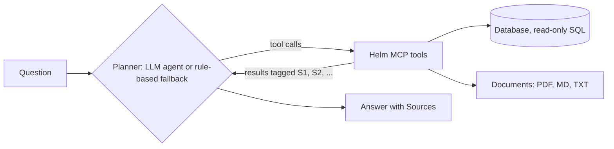

<p></p>

# PeakWhale™ Helm
### Ask your own data. Get answers with sources.


[](https://github.com/PeakWhale/helm/actions/workflows/ci.yml)

**PeakWhale™ Helm** is a local-first research assistant. It answers questions from your database and your documents, and shows where each fact came from: the SQL query and row count, or the file and chunk.

* **MCP server** (`helm-mcp`): plug it into Claude Desktop, Cursor or any MCP client for safe, read-only access to your data.
* **Chat app** (Chainlit): a planner picks the tools for each question. It uses a local model in Ollama, any OpenAI-compatible API, or no model at all (a simple rule-based fallback).

**Who it is for:** analysts and small teams who want answers from their own data (with a local model, the data stays on their own computer), and developers who want a safe data tool for their AI assistant.

> [!NOTE]
> The demo data is synthetic. All names, numbers and documents are made up.

## Quick start (demo)

You need Python 3.11 to 3.14 and [uv](https://docs.astral.sh/uv/).

```bash
git clone https://github.com/PeakWhale/helm && cd helm
uv sync --extra ui            # 1. install (core, LLM agent and chat UI)
uv run helm-demo              # 2. create the demo data
uv run chainlit run app.py    # 3. open http://localhost:8000
```

The chat UI has no login. Keep it on your own computer (Chainlit listens on localhost by default) and do not open it to a network without putting a login in front of it.

Ask: *Find the top high risk customer and check their loan application for income source.*

For full LLM answers, install [Ollama](https://ollama.com) and run `ollama pull llama3.2`. Without a model, Helm still answers simple questions. No UI? Try `uv run helm-ask "How many customers are there?"`.

## How it works



The planner can call several tools and use one result in the next call. Each tool result gets a tag like `[S1]`, the answer cites these tags, and a **Sources** list at the end says which SQL ran (and how many rows came back) or which file and chunk was used.

| Tool | What it does |
| --- | --- |
| `list_tables` / `describe_table` | tables, row counts, columns, sample rows and saved queries |
| `query` | one read-only `SELECT` or `WITH` query, with a row limit |
| `list_documents` / `search_documents` | files, and the best matching chunks with file name and chunk number |
| `get_stock_price` / `analyze_sentiment` | optional, off by default |

Turn the optional tools on with `[tools]` in `helm.toml`, or with `HELM_ENABLE_MARKET=1` (stock prices, calls the internet) and `HELM_ENABLE_SENTIMENT=1` (FinBERT, needs the `ml` extra). In an MCP client, put these in the `env` block.

## Use it with your own data

Point Helm at your data with two environment variables (or edit `helm.toml`), then check what it sees:

```bash
export HELM_DB=/path/to/data      # DuckDB file, SQLite file, or a folder of CSV/TSV/Parquet files
export HELM_DOCS=/path/to/docs    # PDF, Markdown and TXT files (subfolders too); HELM_DOCS= for none
uv run helm-mcp --check
```

Each CSV or Parquet file becomes a table named after the file. PostgreSQL (`HELM_DB=postgresql://user@host/db`) is experimental. When `HELM_DB` points at your data, the demo documents and the demo saved query are left out. In `helm.toml` you can add your own **saved queries**: reviewed SQL with a name and keywords, used with whatever database Helm opens.

**Choose the LLM:** Ollama is the default (`HELM_LLM_MODEL=llama3.2`). For any OpenAI-compatible API, set `HELM_LLM_PROVIDER=openai`, `HELM_LLM_MODEL`, `HELM_LLM_BASE_URL` and `HELM_LLM_API_KEY`. `HELM_LLM_PROVIDER=none` uses only the rule-based fallback.

> [!IMPORTANT]
> Helm runs on your computer, but the rows and text it finds go to the model you use. With a cloud API (`HELM_LLM_PROVIDER=openai` and a hosted service), that data is sent to that company. For fully local use, use Ollama or `HELM_LLM_PROVIDER=none`.

### Settings

Environment variables win over `helm.toml`. `HELM_CONFIG` picks another TOML file (default: `./helm.toml`).

| Environment variable | `helm.toml` key | Default | What it does |
| --- | --- | --- | --- |
| `HELM_DB` | `[database] path` or `url` | `data/ledger.duckdb` | DuckDB file, SQLite file, CSV/TSV/Parquet folder, or `postgresql://...` |
| `HELM_DB_KIND` | `[database] kind` | detected | `duckdb`, `sqlite`, `files` or `postgres` |
| `HELM_DOCS` | `[documents] path` | `data/vault` | documents folder; set it empty for none |
| `HELM_RETRIEVER` | `[documents] retriever` | `bm25` | `bm25` (keywords) or `embeddings` (needs the `ml` extra) |
| `HELM_EMBEDDING_MODEL` | `[documents] embedding_model` | `sentence-transformers/all-MiniLM-L6-v2` | model for `embeddings` |
| `HELM_MAX_ROWS` | `[limits] max_rows` | `200` | most rows one query returns |
| `HELM_QUERY_TIMEOUT` | `[limits] query_timeout_seconds` | `30` | seconds before a query is stopped |
| `HELM_ENABLE_MARKET` | `[tools] market` | off | `get_stock_price` tool (calls the internet) |
| `HELM_ENABLE_SENTIMENT` | `[tools] sentiment` | off | `analyze_sentiment` tool (needs the `ml` extra) |
| `HELM_LLM_PROVIDER` | `[llm] provider` | `ollama` | `ollama`, `openai` (any OpenAI-compatible API) or `none` |
| `HELM_LLM_MODEL` | `[llm] model` | `llama3.2` for Ollama | model name |
| `HELM_LLM_BASE_URL` | `[llm] base_url` | provider default | API address, for example `http://localhost:11434` |
| `HELM_LLM_API_KEY` | (keep keys out of the file) | `OPENAI_API_KEY` if set | API key for `openai` |
| `HELM_LLM_TEMPERATURE` | `[llm] temperature` | `0` | model temperature |
| `HELM_MAX_STEPS` | `[llm] max_steps` | `8` | most tool-calling steps per question |
| `HELM_MCP_TRANSPORT` | | `stdio` | `helm-mcp` transport: `stdio`, `sse` or `streamable-http` |
| `HELM_LOG_LEVEL` | | `INFO` (`helm-mcp`), `WARNING` (`helm-ask`) | log level; logs go to stderr |

## Use the MCP server in Claude Desktop, Cursor and other clients

The MCP server needs only the light core dependencies (no torch), and the quick start install already has them. Add this to your client's config (`claude_desktop_config.json` for Claude Desktop, `.cursor/mcp.json` for Cursor):

```json
{
  "mcpServers": {
    "helm": {
      "command": "uv",
      "args": ["run", "--directory", "/absolute/path/to/helm", "helm-mcp"],
      "env": {
        "HELM_DB": "/absolute/path/to/your/data.duckdb",
        "HELM_DOCS": "/absolute/path/to/your/documents"
      }
    }
  }
}
```

Leave out `env` to use the demo data (run `uv run helm-demo` once first). If the client cannot find `uv`, use its full path (see `which uv`).

> [!IMPORTANT]
> Helm itself runs on your computer, but every query result and document passage it returns goes to the model behind your MCP client. With Claude Desktop, Cursor or another cloud-based client, that data is sent to that company. For fully local use, use a client with a local model, or the Helm chat app with Ollama.

## Safety: how the SQL guard works

Every query, from a person or a model, passes these checks first:

1. **One statement only.** `SELECT 1; DROP TABLE x` is blocked.
2. **Read only.** It must start with `SELECT` or `WITH`. `DROP`, `DELETE`, `ATTACH`, `COPY`, `INSTALL`, `PRAGMA`, `SET` and similar words are blocked anywhere.
3. **Comments and quotes cannot hide a statement.** Comments are removed before the checks. Text must use plain `'...'` quotes: `$$...$$` text, `$1` parameters and backslash escapes in `E'...'` text are blocked, so the guard and the database always agree on where text starts and ends.
4. **No file or network access.** `read_csv`, `glob`, `query()` and file names used as tables (`FROM 'file.csv'`, `FROM "file.csv"`, `FROM file.csv`) are blocked.
5. **Row limit.** Results stop at `HELM_MAX_ROWS`, and the answer says when a result was cut.

The database is locked too, so a gap in the guard is not enough on its own: DuckDB's own parser must also see exactly one `SELECT`; DuckDB and SQLite files open read-only and PostgreSQL is attached read-only; DuckDB can read only the data files themselves (plus an empty, private temp folder); SQLite only allows reads; settings are locked; and slow queries stop at the time limit. The tests are in `tests/test_sql_guard.py` and `tests/test_database.py`.

## Tests and evals

If you installed the UI (`uv sync --extra ui`), you already have everything. Otherwise run `uv sync --extra agent` first. (`uv sync` installs exactly the extras you name and removes the others, so name every extra you want, for example `uv sync --extra ui --extra ml`.)

```bash
uv run pytest                    # offline: no LLM, no network, no model downloads
uv run helm-eval --fresh-demo    # 14 demo questions through the rule-based fallback
uv run helm-eval --llm           # the same questions through your LLM
```

CI runs the tests and the fallback evals on Python 3.11 to 3.14 on every push and pull request, and checks the locked dependencies for known vulnerabilities every week.

## Honest limits

- The rule-based fallback only understands simple questions (row counts of a whole table, lookups by id, saved queries, document lookups). It says so instead of guessing when a question needs more, like a count with a condition. Open questions need an LLM.
- Small local models can still pick the wrong tool or write wrong SQL. The Sources list helps you check, but Helm does not check that the model read the numbers correctly.
- Document search is keyword search (BM25) by default. Semantic search needs the `ml` extra (`uv sync --extra ui --extra ml`), a large download. Files over 50 MB and PDFs over 2000 pages are skipped.
- PostgreSQL support is experimental and not tested.
- The guard blocks some valid SQL on purpose: a column named `load` must be written as `"load"`.

## What it enables businesses to do

* **Private, local-first data Q&A:** Let analysts and operations teams query internal SQL tables and policy PDFs on their own hardware without sending sensitive records to external cloud APIs.
* **Auditable answers with source citations:** Every response lists the exact read-only SQL query and row count or document chunk used, so teams can verify numbers before acting.
* **Drop-in MCP server for AI assistants:** Connect Claude Desktop, Cursor, or internal agent workflows to company data through a read-only SQL guard.

## Connect and customize

Want help adapting **PeakWhale™ Helm** to your own data, workflows, or infrastructure?

* **Book 30 minutes:** [Schedule a working session with Addy](https://adrkv.github.io/meet.html?audience=teams)
* **Portfolio and whitepapers:** [adrkv.github.io](https://adrkv.github.io)
* **LinkedIn:** [Addy Kaveti](https://www.linkedin.com/in/adrkv/) · [PeakWhale™](https://www.linkedin.com/company/peakwhale%E2%84%A2/)

## Part of the PeakWhale™ fleet

PeakWhale™ is an open-source initiative by [Addy Kaveti](https://adrkv.github.io) making practical AI and machine learning accessible to every team:

* **[PeakWhale™ Helm](https://github.com/PeakWhale/helm)**: local-first research assistant over your own SQL databases and documents, with source citations.
* **[PeakWhale™ Orca](https://github.com/PeakWhale/orca)**: self-hosted payment fraud check that scores transactions and explains every decision in plain English.
* **[PeakWhale™ Harbor](https://github.com/PeakWhale/harbor)**: turns any CSV spreadsheet into a prediction web app and JSON API with honest prediction ranges.
* **[PeakWhale™ Trident](https://github.com/PeakWhale/trident)**: fail-safe triage engine pairing AI with editable YAML rule packs so unclear cases always go to a person.
* **[PeakWhale™ Berth](https://github.com/PeakWhale/berth)**: EV depot fleet charging planner that schedules every vehicle to leave ready at the lowest power cost.
* **[PeakWhale™ Pod](https://github.com/PeakWhale/pod)**: domain-agnostic K-means cohort and regional clustering engine with plain-English segment profiles.
* **[PeakWhale™ Pilot](https://github.com/PeakWhale/pilot)**: outcome forecaster and early-warning engine that flags at-risk records and explains the top drivers.

## Legal, trademark, and liability notice

* **Open-source license:** Licensed under the **Apache License 2.0** (© 2025-2026 Aditya Rao (Addy) Kaveti). See [`LICENSE`](LICENSE) and [`NOTICE`](NOTICE). If you distribute, modify, or build on this software, you must retain the [`NOTICE`](NOTICE) file as required by Section 4(d) of the Apache License 2.0.
* **Trademark reservation:** **PeakWhale™** and the PeakWhale project marks and logos are trademarks of Aditya Rao (Addy) Kaveti. Under Section 6 of the Apache License 2.0, this license grants no permission to use the PeakWhale™ name, marks, or logos to endorse or promote derivative products or services without prior written permission.
* **No warranty or professional advice:** This software is provided **"AS IS"**, without warranty or liability of any kind (see Sections 7 and 8 of the Apache License 2.0). Output from this tool does not constitute financial, medical, legal, compliance, or safety advice. You are solely responsible for independent validation, security controls, human oversight, and regulatory compliance before using this software in production.
* **Independent personal project and synthetic data:** Created and maintained by Aditya Rao (Addy) Kaveti in an independent personal capacity. All bundled demo datasets are synthetic or public benchmark examples and contain no proprietary or employer material.
